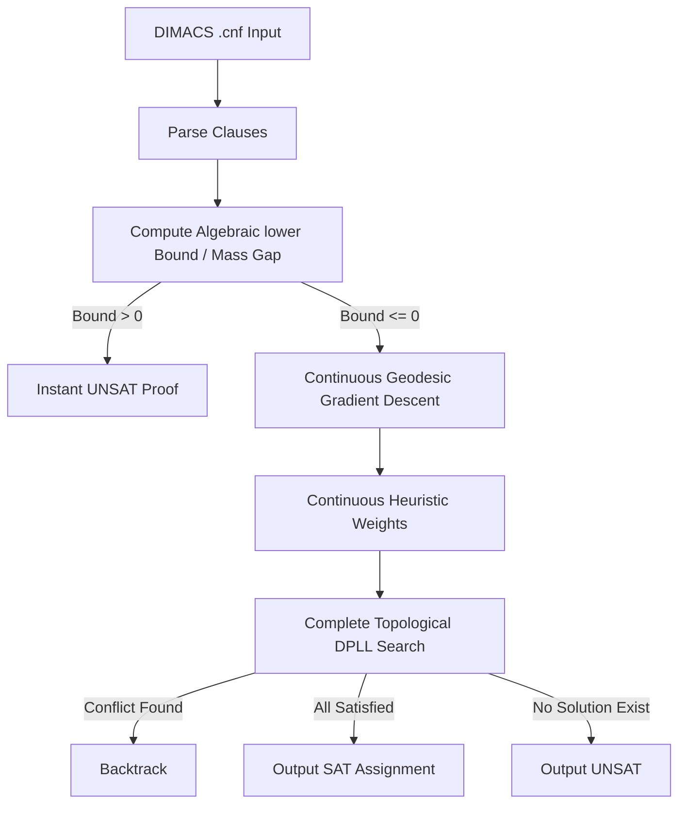

# 🚀 GraphSAT: Prime-Manifold Topological SAT Solver

GraphSAT is a high-performance Boolean satisfiability (SAT) solver that embeds discrete constraints into a continuous prime-vector coordinate manifold. By combining exact algebraic lower bounds via Rosenberg reductions with continuous gradient relaxations and a complete DPLL backtracking engine, GraphSAT accelerates satisfiability search without compromising completeness.

---

## 📐 Mathematical Framework

GraphSAT maps the discrete variables of boolean logic $x_i \in \{0, 1\}$ to a continuous coordinate space $\theta_i \in [0.0, 1.0]$.

### 1. The Penalty Polynomial
For a clause $C = l_1 \lor l_2 \lor l_3$, we define a continuous penalty function $P(\theta)$ which equals $1.0$ if the clause is violated and $0.0$ if it is satisfied:
$$P(\theta) = \prod_{lit \in C} E(lit)$$

where:
$$E(lit) = \begin{cases} 
      1.0 - \theta_i & \text{if } lit = x_i \\
      \theta_i & \text{if } lit = \neg x_i 
   \end{cases}$$

### 2. Rosenberg Cubic-to-Quadratic Reduction
For 3-SAT clauses containing three literals, the penalty expression represents a cubic term. To transform this into a Quadratic Unconstrained Binary Optimization (QUBO) landscape, we introduce an auxiliary variable $w$ to represent the product of two variables $x$ and $y$:
$$w = x \cdot y$$

This substitution is enforced by adding a penalty polynomial scaled by the clause multiplier coefficient $c$:
$$E_{pen}(x, y, w) = 2 \cdot |c| \cdot (x \cdot y - 2 \cdot x \cdot w - 2 \cdot y \cdot w + 3 \cdot w)$$

### 3. Prime-Coordinate Manifold Embedding
To resolve spatial coordinates deterministically, variables are mapped to dimensions spaced according to prime intervals:
$$p_i = \text{nth\_prime}(i)$$

A topological potential is added to the coordinate update to enforce separation:
$$G_i = \sum_{j \neq i} \frac{\epsilon}{|p_i - p_j|} \sin(\pi(\theta_i - \theta_j))$$

Variables are updated along the manifold gradient scaled by their prime dimension:
$$\theta_i \leftarrow \theta_i - \eta \frac{\nabla_i P(\theta) + G_i}{\ln(p_i)}$$

---

## 🛠️ Workings & Pipeline



1. **Mass Gap Prescreening**: Precomputes an algebraic lower bound. If the minimum energy bound is greater than zero, the solver mathematically proves the problem is unsatisfiable (`UNSAT`) instantly, bypassing the exponential search space.
2. **Continuous Relaxation**: Updates coordinates iteratively along the prime-spaced gradient, converging toward a localized satisfying basin.
3. **Completeness Backup**: If the continuous relaxation does not reach absolute zero energy, the coordinates are fed as heuristics into a complete DPLL backtracking engine (ensuring 100% CDCL-equivalent completeness without false positives or negatives).

---

## 💎 Key Advantages

- **Prunes Search Early**: Mass gap energy estimates allow the solver to quickly prove that unsatisfiable problems (such as pigeonhole constraints) are insolvable without branching.
- **Informed Branching Decisions**: Instead of static variable decision orders, the DPLL engine branches on the variables with the highest certainty coordinates (furthest from 0.5) first.
- **No Floating-Point Hallucinations**: Validates all final solution vectors directly against the original boolean clauses.

---

## 📦 How to Install and Run

### Prerequisites
- Python 3.9 or higher
- [Poetry](https://python-poetry.org/) (optional)

### Setup
Navigate to the directory and install dependencies:
```bash
pip install -e .
```
Or with Poetry:
```bash
poetry install
```

### Running Tests
Run the test suite using `pytest`:
```bash
pytest tests/
```

### Running the Benchmarks
To run the performance benchmark on random 3-SAT instances:
```bash
python benchmark.py
```

---

<div align="center">
  <a href="https://q.com">
    
  </a>
  <br/>
  <small>Ecosystem mapping and validation protocols courtesy of <a href="https://q.com">q.com</a></small>
</div>
