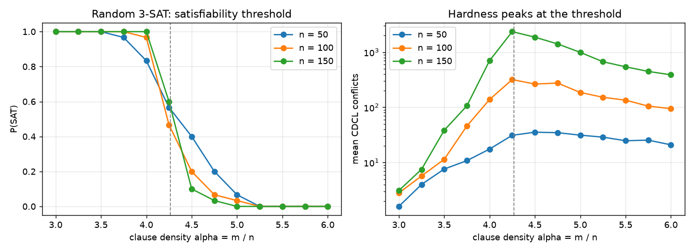
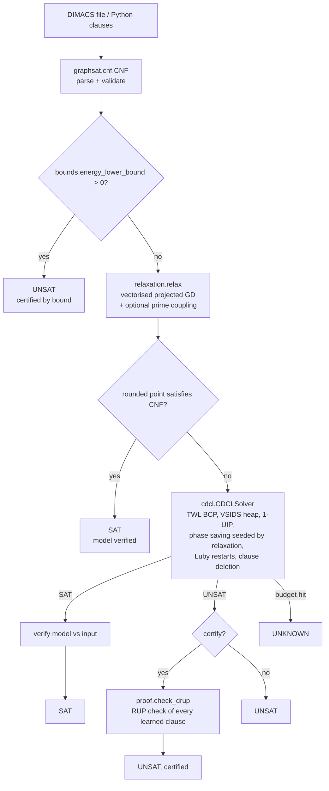

# GraphSAT: a verified CDCL SAT solver in Python with a measured continuous-relaxation experiment

[](https://github.com/Cyb0rg137ms/graphsat_solver/actions/workflows/ci.yml)

[](LICENSE)

GraphSAT checks every answer it gives. SAT models are re-checked against the input, and UNSAT answers can carry a DRUP proof that is verified by a built-in RUP checker. Its experimental continuous relaxation is treated as a hypothesis to measure, not a claimed speedup.



*Measured with `graphsat bench --n 50 100 150 --alpha-min 3 --alpha-max 6 --steps 13 --trials 30`: P(SAT) drops sharply near the known threshold α ≈ 4.27 (dashed line), and mean CDCL conflicts peak there, increasingly with n. Raw rows: [`docs/assets/phase.json`](docs/assets/phase.json).*

## Why it matters

SAT solvers sit inside verifiers, planners and schedulers, where a wrong "UNSAT" silently turns a bug into a "proof". The original version of this repo hung on PHP(4,3) and had an unsound learning rule. GraphSAT fixes those bugs and makes soundness checkable, so an answer is backed by a model check or a DRUP certificate. It also measures whether the physics-inspired relaxation actually helps. On random 3-SAT, it does not.

## Key results (measured; single thread, CPython 3.13.5, shared Xeon VM)

**Hardness peak at the threshold** (30 instances per point; rows from `docs/assets/phase.json`):

| n | α | P(SAT) | median ms | mean conflicts |
|---|---|---|---|---|
| 50 | 4.25 | 0.57 | 1.99 | 31.1 |
| 100 | 4.25 | 0.47 | 29.53 | 318.2 |
| 150 | 3.00 | 1.00 | 1.40 | 3.1 |
| 150 | 4.25 | 0.60 | 361.53 | 2353.3 |
| 150 | 6.00 | 0.00 | 46.08 | 388.1 |

**Ablation** (n = 150, α = 4.26, 20 instances, 7 SAT / 13 UNSAT; all variants agree on every answer):

| Variant | mean time | mean conflicts |
|---|---|---|
| CDCL only | 514.6 ms | 2843 |
| Hybrid (relaxation hints + prime coupling) | 549 ms | 2787 |
| Hybrid, coupling off | 547 ms | 2921 |
| Hybrid, hints off | 565 ms | 2843 |

**Takeaway:** on random 3-SAT the relaxation does not pay for itself. It cuts conflicts by about 2% at best and adds wall-clock overhead. The prime coupling shows no consistent benefit. PHP(8,7), a classic hard UNSAT family for resolution, solves in about 1.2 s.

**Correctness:** 222 tests, about 1 s. They cover brute-force agreement, DRUP validity including rejection of bogus proofs, lower-bound soundness and QUBO exactness checked by brute force, finite-difference gradients, DIMACS edge cases and the CLI.

Reproduce:
```bash
pip install -e ".[dev]"
graphsat bench --n 50 100 150 --alpha-min 3.0 --alpha-max 6.0 --steps 13 --trials 30 \
  --json docs/assets/phase.json --plot docs/assets/phase_transition.png
pytest
```

## Architecture



Module map and details: [docs/ARCHITECTURE.md](docs/ARCHITECTURE.md).

## 60-second quickstart

```bash
git clone https://github.com/Cyb0rg137ms/graphsat_solver && cd graphsat_solver
pip install -e .
graphsat gen random --n 100 --alpha 4.26 --seed 0 > f.cnf
graphsat solve f.cnf --certify --proof f.drup ; echo "exit=$?"   # 10 = SAT, 20 = UNSAT
```

Docker: `docker build -t graphsat . && docker run --rm graphsat --help`

## Usage

```python
from graphsat import HybridSolver, SolverConfig, solve
from graphsat.generators import pigeonhole

print(solve([[1, -2], [2, 3], [-1, -3]]).status)  # SAT
r = HybridSolver(pigeonhole(6, 5), SolverConfig(certify=True)).solve()
print(r.status, r.certified)  # UNSAT True (DRUP-checked)
```

* `graphsat solve f.cnf --config examples/config.toml` loads solver options from TOML.
* More examples are in [`examples/quickstart.py`](examples/quickstart.py).

### Features
- **CDCL solver:**
  - two-watched-literal propagation and a VSIDS heap
  - first-UIP learning with non-chronological backjumping
  - phase saving, Luby restarts and LBD-based learned-clause deletion
  - optional DRUP proof logging
- **Sound polynomial lower bound** on the number of violated clauses, plus an exact **QUBO export** (Rosenberg reduction) for annealers and Ising solvers.
- **Vectorised relaxation** in NumPy:
  - exact gradients and a seeded projected gradient descent
  - an optional prime-spaced coupling heuristic that you can turn off for ablations
  - results feed CDCL phase hints
- **Generators** for random k-SAT, planted k-SAT, pigeonhole and graph colouring instances.
- **Tooling:**
  - `graphsat` CLI with SAT-competition exit codes (10 = SAT, 20 = UNSAT)
  - TOML config file
  - benchmark harness, Dockerfile and typed API (mypy-clean)

Architecture diagram and module map: [docs/ARCHITECTURE.md](docs/ARCHITECTURE.md). Known limitations: [docs/LIMITATIONS.md](docs/LIMITATIONS.md).

## Design decisions and trade-offs

* **Pure Python + NumPy.** It is easy to read and to install, but it is orders of magnitude slower than C solvers such as MiniSat or Kissat. Use it for research and teaching, not industrial instances.
* **Verify everything.** Model checks are always on. DRUP certification is opt-in because proof logging and checking cost time.
* **The relaxation stays, as an ablatable option.** The measured result is negative (see the table above), but hint, coupling and bound can each be switched off, so the experiment is reproducible.
* **The lower bound is sound but weak.** It can prove UNSAT only for small or structured formulas, and otherwise falls through to CDCL.

### Bugs fixed relative to the original version
- The learned clause negated literals from other levels, which made it unsound.
- Backjumping unassigned the entire trail, including level 0.
- The watch invariant was broken for learned clauses. Together with the two bugs above, this made PHP(4,3) and K4 3-colouring hang.
- DPLL did not undo unit propagations on backtrack.
- The lower bound dropped the x² = x terms, which made it unsound.
- Randomness was unseeded, and an O(n²) Python loop is now vectorised.
- The previous README and benchmark claims were not reproducible and have been removed.

## Limitations and roadmap

* No preprocessing (BVE or subsumption), no inprocessing and no incremental API yet.
* Industrial-size instances are out of reach in pure Python.
* The relaxation gives no measurable benefit on random 3-SAT. Structured families are untested.
* Details are in [docs/LIMITATIONS.md](docs/LIMITATIONS.md).
* Roadmap: SATLIB/SAT-competition subsets in the benchmark harness, a DRAT (not only DRUP) checker, and a Cython or Rust BCP core.

## Citation

```bibtex
@software{graphsat2026,
  author = {Cyb0rg137ms},
  title  = {GraphSAT: a verified CDCL SAT solver in Python with a measured continuous-relaxation experiment},
  year   = {2026},
  url    = {https://github.com/Cyb0rg137ms/graphsat_solver}
}
```

## License

MIT. See [LICENSE](LICENSE).
