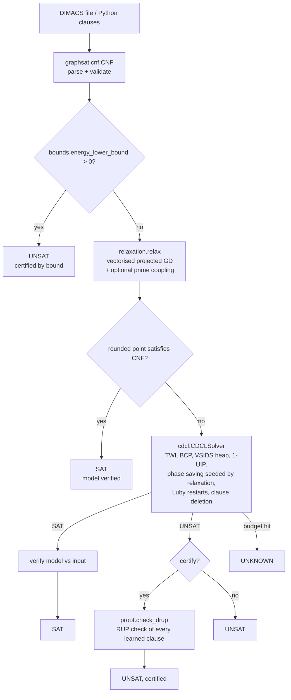

# Architecture

| Module | Responsibility |
|---|---|
| `graphsat/cnf.py` | `CNF` container, strict/lenient DIMACS parsing (multi-line clauses, `%` terminator), serialisation, evaluation |
| `graphsat/cdcl.py` | Complete CDCL solver; optional DRUP logging; returns `SolveResult` |
| `graphsat/proof.py` | DRUP writer (drat-trim compatible text) and a reference RUP checker |
| `graphsat/bounds.py` | Multilinear clause energy, sound lower bound, exact Rosenberg QUBO export |
| `graphsat/relaxation.py` | NumPy clause tensors, exact gradients, seeded projected gradient descent |
| `graphsat/core.py` | `HybridSolver` pipeline + backward-compatible `ManifoldConstraintSolver` |
| `graphsat/config.py` | `SolverConfig` dataclass, TOML loading |
| `graphsat/generators.py` | Random k-SAT, planted k-SAT, pigeonhole, graph colouring |
| `graphsat/cli.py` | `graphsat solve | gen | bench` |
| `graphsat/benchmarks/` | Phase-transition sweep and ablations |

## Invariants checked by the test-suite

* CDCL answers match brute-force enumeration on hundreds of random small formulas.
* Every SAT model is re-evaluated against the *input* clauses.
* Every UNSAT answer produced with `proof=True` in the tests is accepted by the RUP checker; a bogus proof is rejected.
* The polynomial lower bound never exceeds the true minimum number of violated clauses (brute force).
* The QUBO satisfies `min_w Q(x, w) = #violated(x)` for every `x` (brute force).
* The analytic relaxation gradient matches central finite differences.
